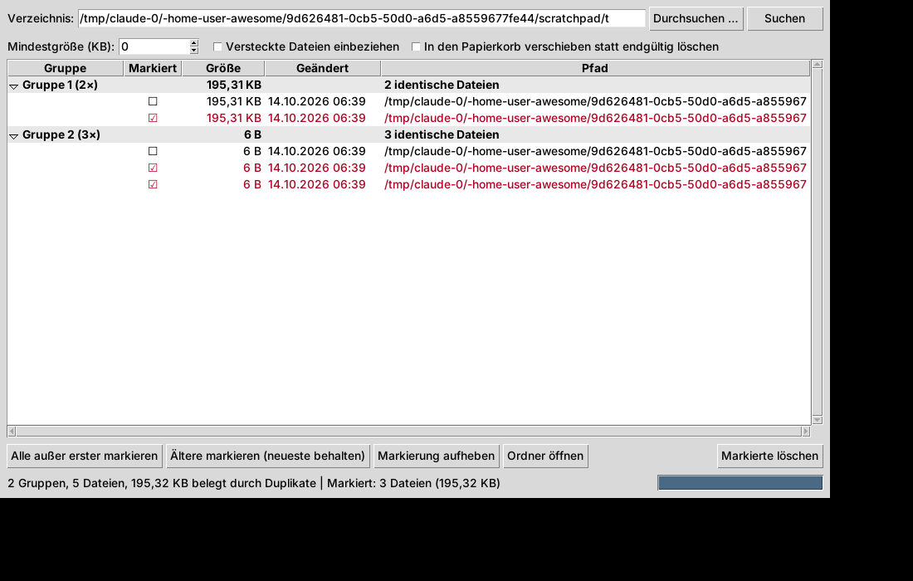

# Doppelte Dateien finden

Grafische Linux-Anwendung (Python + Tkinter), die ein Verzeichnis rekursiv nach
Dateien mit identischem Inhalt durchsucht, sie gruppiert mit Größe und
Änderungsdatum anzeigt und das Markieren und Löschen erlaubt.



## Voraussetzungen

- Python 3.8 oder neuer
- Tkinter, z. B. unter Debian/Ubuntu/Mint: `sudo apt install python3-tk`
  (Fedora: `sudo dnf install python3-tkinter`, Arch: `sudo pacman -S tk`)
- Optional für den Papierkorb: `gio` (bei GNOME, Cinnamon, XFCE meist vorhanden)
  oder `pip install send2trash`

## Starten

```sh
python3 duplicate_finder.py            # oder
python3 duplicate_finder.py ~/Bilder   # Startverzeichnis vorgeben
```

## Bedienung

1. Verzeichnis eintragen oder über **Durchsuchen …** wählen, dann **Suchen**
   (während der Suche wird der Knopf zu **Abbrechen**).
2. Doppelte Dateien erscheinen in Gruppen mit Größe, Änderungsdatum und Pfad.
3. Markieren:
   - Klick in die Spalte **Markiert** schaltet eine Datei um,
   - **Leertaste** schaltet alle ausgewählten Zeilen um (auf einer Gruppenzeile: alle Dateien der Gruppe),
   - **Alle außer erster markieren** bzw. **Ältere markieren (neueste behalten)**,
   - **Markierung aufheben**.
4. **Markierte löschen** (oder Taste **Entf**). Standardmäßig landen die Dateien
   im Papierkorb; ohne Haken wird endgültig gelöscht. Sind in einer Gruppe alle
   Kopien markiert, gibt es eine zusätzliche Warnung.

Doppelklick auf eine Datei öffnet sie, **Ordner öffnen** zeigt den Speicherort.

## Funktionsweise

Dateien werden zuerst nach Größe gruppiert, dann nach einem Hash der ersten
64 KB und schließlich nach einem BLAKE2-Hash des gesamten Inhalts verglichen.
Symbolische Links werden übersprungen, Hardlinks auf dieselbe Datei nur einmal
gezählt. Versteckte Dateien/Ordner werden nur auf Wunsch einbezogen.
